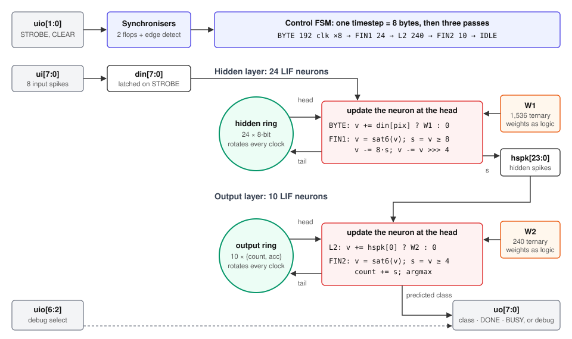
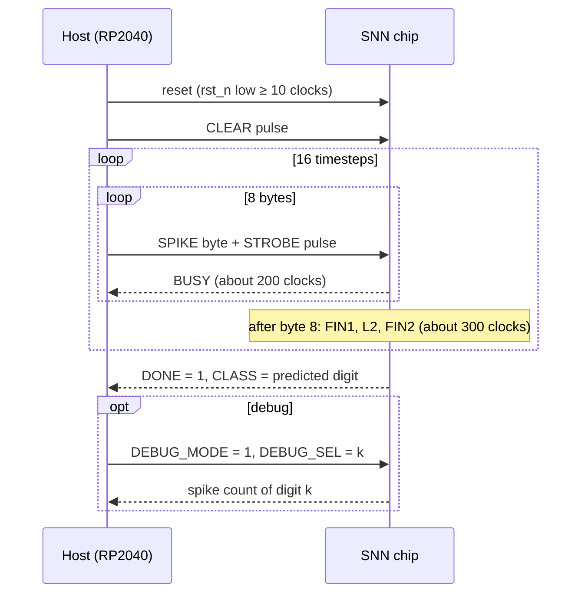

   

# SNN MNIST Digit Classifier

## Overview

A **spiking neural network** in silicon for [Tiny Tapeout](https://tinytapeout.com) (sky130). It classifies handwritten MNIST digits with 64 input spikes, 24 hidden and 10 output leaky integrate-and-fire neurons, and 1,776 hardwired ternary weights.

**Author:** Nitya Shah

| | |
|---|---|
| Size | 1x2 tiles |
| Clock | 10 MHz nominal (timing signed off at 50 MHz) |
| Accuracy | 86.83% on the 10,000-image MNIST test set |
| Verification | RTL bit-exact with the reference model on all 10,000 test images |

How it works and how to use it: [docs/info.md](docs/info.md)

---

## Contents

- [At a glance](#at-a-glance)
- [The network](#the-network)
- [Architecture](#architecture)
- [How it works](#how-it-works)
- [Pinout](#pinout)
- [Talking to the chip](#talking-to-the-chip)
- [Verification](#verification)
- [Physical design](#physical-design)
- [From training to silicon](#from-training-to-silicon)
- [Build it yourself](#build-it-yourself)
- [Repository map](#repository-map)

## At a glance

| | |
|---|---|
| **Function** | classify an 8×8 handwritten digit as 0–9 |
| **Network** | 64 inputs → 24 LIF → 10 LIF, spike-count readout |
| **Weights** | 1,776 ternary weights (−1, 0, +1), 1,530 non-zero, hardwired as logic |
| **Input** | 8×8 image at 2-bit levels, rate-coded into 16 timesteps × 64 spikes, sent as 128 bytes |
| **Neurons** | 6-bit saturating membranes, shift-based leak `v >>> 4`, subtractive reset |
| **Compute time** | about 2,000 clocks per timestep, so one image takes about 3.3 ms at 10 MHz |
| **Arithmetic** | one 8-bit and one 7-bit adder in total, 0 multipliers |
| **Storage** | 397 flip-flops, no RAM |
| **Accuracy** | 86.83% on MNIST test (10,000 images), digits 0 and 1 at about 97% |
| **Process** | SkyWater sky130A, `sky130_fd_sc_hd` standard cells |
| **Language** | Verilog, about 200 lines of RTL plus a generated weight table |
| **License** | Apache-2.0 |

## The network


A spiking network computes with **events over time** instead of numbers in one shot. Each pixel becomes a train of spikes: a brighter pixel spikes more often. Every neuron keeps a **membrane voltage** that rises with weighted input spikes, slowly **leaks** back toward zero, and **fires** a spike of its own when it crosses a threshold. The digit is whichever output neuron fires most often over 16 timesteps.

The figure above is real data: test image 0 (a 7) run through the exact integer model the chip implements. Output neuron 7 fires in 11 of 16 timesteps. The next closest, neuron 9, fires 3 times.

| Layer | Neurons | Threshold θ | Leak | Membrane |
|---|---:|---:|---|---|
| Input | 64 (8×8 pixels) | | rate code, period 4 | |
| Hidden | 24 | 8 | `v −= v >>> 4` | 6-bit, saturating |
| Output | 10 | 4 | `v −= v >>> 4` | 6-bit, saturating, plus a 5-bit spike counter |

### Accuracy by digit

| Digit | 0 | 1 | 2 | 3 | 4 | 5 | 6 | 7 | 8 | 9 |
|---|---:|---:|---:|---:|---:|---:|---:|---:|---:|---:|
| Correct | 96.9% | 96.5% | 87.2% | 83.8% | 85.6% | 79.5% | 90.5% | 84.0% | 78.5% | 83.8% |

The most common mistakes are 4 ↔ 9, 8 → 5 and 3 → 5. That's what you'd expect when a 28×28 digit is shrunk to 8×8 and 2 bits per pixel.

### Why these sizes?

A size sweep (in [`model/`](model/)) traded accuracy against neuron state bits, which dominate area:

| Hidden neurons | Membrane bits | Test accuracy | Membrane + counter bits |
|---:|---:|---:|---:|
| 0 (single layer) | 8 | 79.3% | 130 |
| 16 | 8 | 82.4% | 258 |
| **24** | **6** | **86.8%** | **254** |
| 32 | 8 | 87.3% | 386 |

24 hidden neurons with 6-bit membranes is within half a point of the largest network and costs far less area.

## Architecture



Two files of RTL:

| File | Module | What it does |
|---|---|---|
| [`src/project.v`](src/project.v) | `tt_um_nityashah1811_snn_mnist` | pins, synchronisers, FSM, neuron rings, LIF datapaths, argmax, debug readout |
| [`src/snn_weights.v`](src/snn_weights.v) | `snn_w1`, `snn_w2` | the trained ternary weights as two lookup tables (generated) |

### Where the 397 flip-flops go

Every flop is accounted for, and the total matches the synthesised netlist exactly.

| Block | Flops | Notes |
|---|---:|---|
| Hidden ring | 192 | 24 neurons × 8 bits (6-bit membrane plus headroom for the pre-saturation sum) |
| Output ring | 120 | 10 neurons × (7-bit accumulator + 5-bit spike count) |
| Hidden spike register | 24 | spikes of the current timestep, routed to the output layer |
| Input byte | 8 | the latched spike byte |
| Synchronisers | 6 | 2 strobes × 3 stages |
| Control | 47 | FSM state, ring pointers, pixel/byte/neuron/step counters, argmax, prediction, debug |
| **Total** | **397** | |

## How it works

### 1. Rotating neuron rings: one adder for 24 neurons

All neuron state lives in two **shift-register rings** that rotate one position **every clock**, whether or not anything is happening. Each clock, the neuron at the head is read, optionally updated, and written back at the tail. Counters `hp` and `op` track which neuron is at each head.

Rotating every clock is deliberate. A ring that only moves when told to needs an enable multiplexer on every one of its 312 flops. A free-running ring needs none, so all the arithmetic sits in one small datapath at the head. The FSM just waits until neuron 0 comes round before starting a pass.

### 2. Integrate: one pixel per rotation

When a spike byte arrives, the hidden ring makes **8 full rotations**, one per pixel in the byte. On rotation `pix`, every neuron passing the head adds its weight for that pixel if the pixel spiked:

```
v += din[pix] ? W1[neuron][8*byte + pix] : 0          (W1 is −1, 0 or +1)
```

The weight comes from a 1,536-entry table **compiled into logic**, addressed by `{hp, byte, pix}`. There's no ROM to load and no memory to get wrong. Synthesis folds the constants into gates.

### 3. Fire: finalise each layer once per timestep

After the 8th byte, a single rotation (**FIN1**) finalises all 24 hidden neurons:

```
v = sat6(v)              clamp to [−32, 31]
s = (v ≥ 8)              fire?
v = v − 8·s              subtractive reset
v = v − (v >>> 4)        leak, applied now for the next timestep
```

The 24 spikes go into `hspk`. Then **L2** routes them to the output layer: for each hidden neuron `j` (24 output-ring rotations), every output neuron adds `W2[k][j]` if `j` fired. **FIN2** finalises the 10 outputs (θ = 4), adds each spike to its 5-bit counter, and updates a running argmax.

Applying the leak right after the reset gives exactly the same result as applying it at the start of the next step, because nothing touches the neuron in between. This saves a pass.

### 4. A neuron, timestep by timestep

Hidden neuron 13 on test image 0, from the integer model the chip matches:

| Step | v at start | after leak | input Σw·s | v after sat6 | fires? | v after reset |
|---:|---:|---:|---:|---:|:---:|---:|
| 0 | 0 | 0 | 0 | 0 | | 0 |
| 1 | 0 | 0 | +2 | 2 | | 2 |
| 2 | 2 | 2 | −1 | 1 | | 1 |
| 3 | 1 | 1 | +5 | 6 | | 6 |
| 4 | 6 | 6 | 0 | 6 | | 6 |
| 5 | 6 | 6 | +2 | 8 | **yes** | 0 |
| 6 | 0 | 0 | −1 | −1 | | −1 |
| 7 | −1 | **0** | +5 | 5 | | 5 |

Step 7 shows a detail of the shift-based leak: `−1 >>> 4 = −1`, so a membrane of −1 leaks to 0. The chip, the C++ model and the PyTorch training model all agree on this.

### 5. Clock budget

| Phase | Clocks | Notes |
|---|---:|---|
| Load one byte | ≤ 23 + 192 | align to neuron 0, then 8 rotations of 24 |
| FIN1 | 24 | one hidden rotation |
| L2 | ≤ 9 + 240 | align, then 24 rotations of 10 |
| FIN2 | 10 | one output rotation |
| **One timestep** | **about 2,000** | 8 bytes plus the three passes |
| **One image** | **about 33,000** | 3.3 ms at 10 MHz |

With a microcontroller bit-banging the pins, the host is the bottleneck, not the chip.

## Pinout

| Pin | Name | Dir | Meaning |
|---|---|:---:|---|
| `ui[7:0]` | `SPIKE[7:0]` | in | 8 input spikes: bit i of byte b is pixel 8b+i (pixel = row·8 + col) |
| `uio[0]` | `STROBE` | in | rising edge: accept the byte on `ui` |
| `uio[1]` | `CLEAR` | in | rising edge: zero all neurons, counts and counters |
| `uio[2]` | `DEBUG_MODE` | in | 1: `uo` shows the debug word selected by `uio[6:3]` |
| `uio[6:3]` | `DEBUG_SEL` | in | 0–9: spike count of that digit · 10: step counter · 11: byte index · 15: `0xA5` |
| `uio[7]` | | | unused |
| `uo[3:0]` | `CLASS` | out | predicted digit (running argmax, final when `DONE`) |
| `uo[4]` | `DONE` | out | all 16 timesteps received |
| `uo[5]` | `BUSY` | out | computing: wait before the next byte |
| `uo[6]` | `STEP_START` | out | the next byte begins a new timestep |
| `uo[7]` | | out | 0 |

All `uio` pins are inputs (`uio_oe = 0`). `STROBE` and `CLEAR` pass through 2-flop synchronisers with edge detection, so the host can be a slow microcontroller on its own clock. Hold each strobe level for at least 4 clocks, and keep `ui` steady while `STROBE` is high.

## Talking to the chip



1. **Reset** (`rst_n` low for at least 10 clocks, clock running), then pulse **CLEAR**.
2. **Encode** the 8×8 image: pixel level q ∈ {0..3} spikes at timestep t when `⌊(t+1)q/4⌋ > ⌊tq/4⌋`.
3. **Send** 16 timesteps × 8 bytes. For each byte: put it on `ui`, raise `STROBE` for at least 4 clocks, lower it, then wait for `BUSY = 0`.
4. **Read** `CLASS` once `DONE = 1`. Extra bytes are ignored until the next `CLEAR`.

```python
def encode(levels):                       # 64 levels, 0..3
    return [sum(1 << p for p in range(64)
                if ((t + 1) * levels[p]) // 4 > (t * levels[p]) // 4)
            for t in range(16)]

pulse(CLEAR)
for word in encode(levels):
    for b in range(8):
        SPIKE = (word >> (8 * b)) & 0xFF; pulse(STROBE)
        while BUSY: pass
digit = CLASS                             # DONE is now 1
```

A MicroPython driver for the Tiny Tapeout demo board is in [`host/snn_demo.py`](host/snn_demo.py). It hasn't been run on silicon yet.

## Verification

The chip is checked against the same integer model at every level, from PyTorch down to the gate-level netlist. Every check compares the predicted digit **and all 10 spike counts**.

```
PyTorch model (training) ──bit-exact──► NumPy integer model ──► test_vectors.txt (10,000 images)
                                                                  │
            C++ golden model (Vitis HLS C-sim + C/RTL co-sim) ◄────┤
            Verilog RTL, pin-level, through the real protocol ◄────┤
            Yosys gate-level netlist, same testbench          ◄────┤
            sky130 gate-level netlist (cocotb, GitHub CI)     ◄────┘
```

| Check | Result |
|---|---|
| PyTorch model vs NumPy integer model | identical spike counts on all 10,000 test images |
| C++ model ([`model/cpp/`](model/cpp/)) | 10,000 / 10,000 bit-exact, also through Vitis HLS C-sim and C/RTL co-sim |
| **RTL**, pin-level testbench ([`sim/`](sim/)) | **10,000 / 10,000 bit-exact**, 86.83% accuracy |
| Yosys gate netlist, same testbench | 2,000 / 2,000 bit-exact |
| Protocol edge cases (RTL and gates) | clear mid-image, clear while computing, reset mid-computation, strobe/clear held across reset, bytes after done, random handshake timing |
| cocotb in CI ([`test/test.py`](test/test.py)) | RTL and the routed sky130 gate-level netlist |
| Structural | no latches, no combinational loops, no Yosys warnings |

The local pin-level testbench uses [Yosys CXXRTL](https://yosyshq.readthedocs.io/projects/yosys/en/latest/cmd/write_cxxrtl.html), which compiles the design into a cycle-accurate C++ simulator. About 390 million clock cycles were simulated in total.

## Physical design

*To be filled in from the GitHub `gds` action: layout render, utilisation, timing slack across corners, and signoff results.*

Pre-layout estimate from Yosys mapped to the sky130_fd_sc_hd cell areas:

| | |
|---|---|
| Cell area | about 13,700 µm² (397 flip-flops = 7,950 µm²) |
| 1x2 slot | about 36,000 µm², so roughly 38% before clock tree and buffers (Tiny Tapeout target density: 60%) |
| Clock | signed off at 50 MHz (`CLOCK_PERIOD = 20` ns), operated at 10 MHz |

## From training to silicon

| Stage | Where | What |
|---|---|---|
| 1. Train | [`model/snn_model.py`](model/snn_model.py), [`model/explore.py`](model/explore.py) | PyTorch SNN whose forward pass **is** the integer hardware maths (ternary weights, shift leak, saturation), trained with surrogate gradients |
| 2. Export | [`model/export.py`](model/export.py) | checks the integer model against PyTorch, writes weights and `test_vectors.txt` |
| 3. Golden C++ | [`model/cpp/`](model/cpp/) | synthesizable C++ reference, verified with Vitis HLS |
| 4. RTL | [`src/`](src/), [`model/gen_weights.py`](model/gen_weights.py) | hand-written Verilog; weights generated into `snn_weights.v` |
| 5. Verify | [`sim/`](sim/), [`test/`](test/) | pin-level simulation on RTL and gates, cocotb in CI |
| 6. Harden | GitHub `gds` action | LibreLane on sky130A |

The Vitis HLS RTL was **not** used for tapeout. It needed about 6,800 flip-flops and 9,300 LUTs, roughly 20× the 1x2 budget, and stored the weights in `$readmemh` ROMs, which an ASIC can't load. The HLS C++ remains the golden model, and the hand-written RTL matches it bit for bit.

## Build it yourself

**cocotb tests** (RTL), the same tests CI runs:

```bash
cd test && pip install -r requirements.txt && make -B
```

**Full pin-level regression** (all 10,000 images on RTL, 2,000 on gates). Needs no simulator install:

```bash
pip install yowasp-yosys ziglang
bash sim/run_sim.sh
```

**Retrain and re-export:**

```bash
cd model
python explore.py                     # size sweep, saves checkpoints
python export.py --ckpt ckpt_8x8_h24_v6_e30.pt --hidden 24 --theta 8 4 --leak 4 4 --vbits 6 --out .
python gen_weights.py                 # regenerates ../src/snn_weights.v
```

**Harden to GDS:** push to GitHub. The `gds` action builds the layout, runs the precheck and the gate-level tests, and publishes the viewer.

## Repository map

```
src/        RTL: project.v (top), snn_weights.v (generated weights), config.json (flow settings)
test/       cocotb tests (RTL + gate level) and golden test vectors
sim/        CXXRTL pin-level testbench, full 10,000-image regression
model/      PyTorch training, integer reference, export, weight generator, checkpoint
model/cpp/  synthesizable C++ golden model and Vitis HLS script
host/       MicroPython driver for the Tiny Tapeout demo board
docs/       info.md (the Tiny Tapeout datasheet page) and README figures
info.yaml   Tiny Tapeout project metadata and pinout
```

Released under the [Apache-2.0 license](LICENSE).
