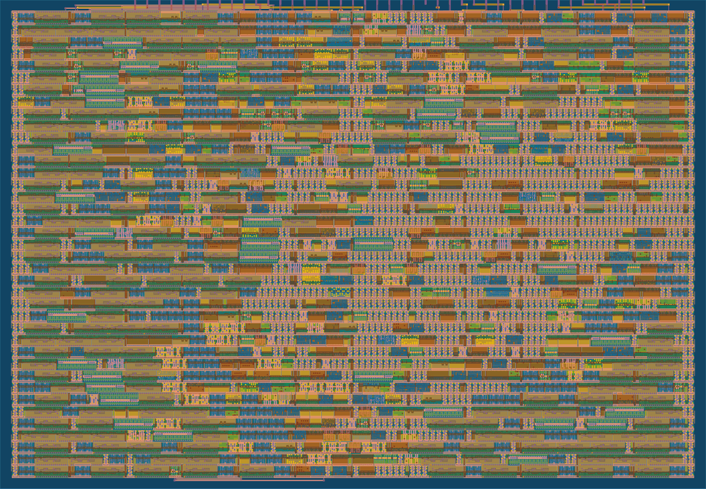
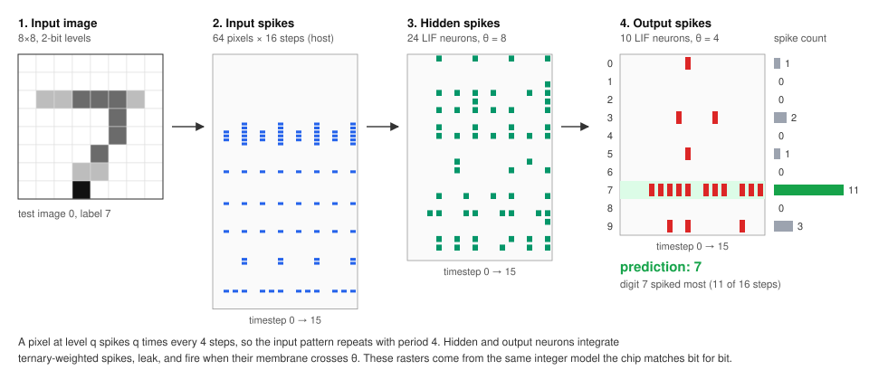
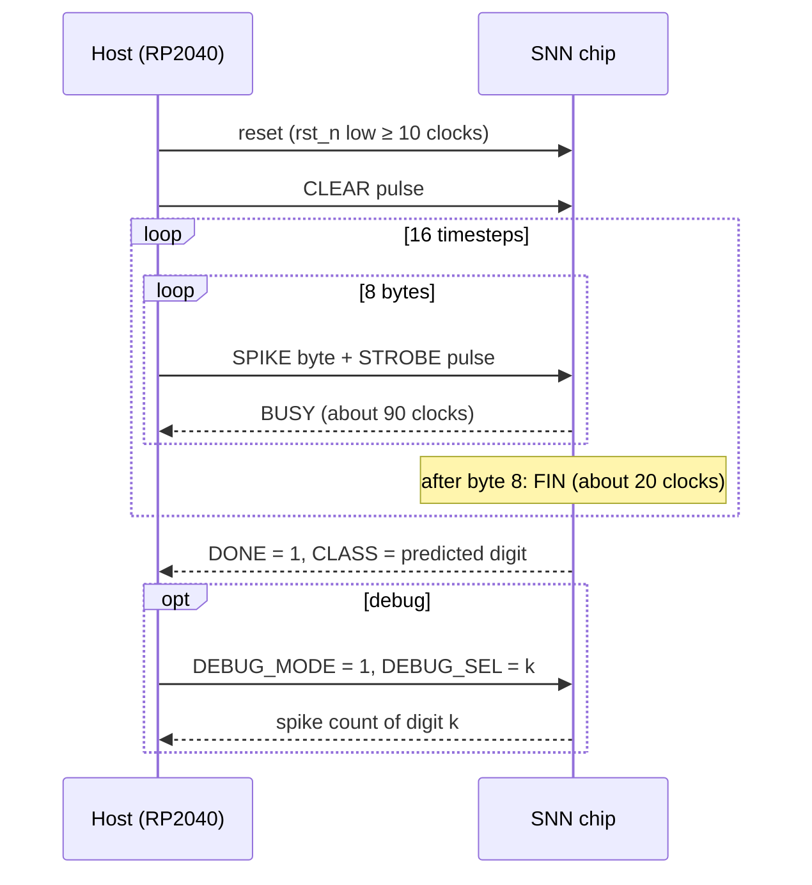
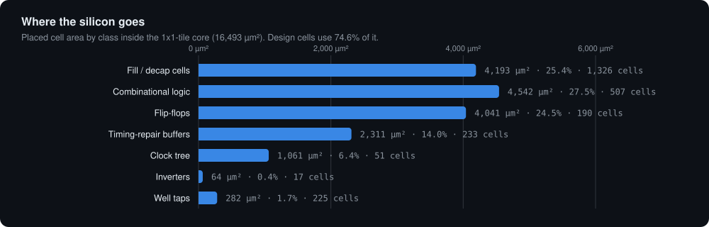
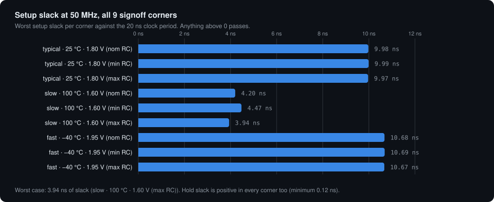

   

# SNN MNIST Digit Classifier

## Overview

A **spiking neural network** in silicon for [Tiny Tapeout](https://tinytapeout.com) (sky130), in a single 1x1 tile. It classifies handwritten MNIST digits with 64 input spikes, 10 leaky integrate-and-fire neurons and 640 hardwired ternary weights.

**Author:** Nitya Shah



| | |
|---|---|
| Size | 1x1 tile |
| Clock | 10 MHz nominal, timing closed at 50 MHz |
| Accuracy | 79.26% on the 10,000-image MNIST test set |
| Checks | precheck, DRC, LVS, timing and gate-level tests all pass |

How it works and how to test it: [docs/info.md](docs/info.md)

---

## Contents

- [Explore the chip in 3D](#explore-the-chip-in-3d)
- [At a glance](#at-a-glance)
- [The network](#the-network)
- [Architecture](#architecture)
- [How it works](#how-it-works)
- [Pinout](#pinout)
- [Talking to the chip](#talking-to-the-chip)
- [Verification](#verification)
- [Physical design](#physical-design)
- [From training to silicon](#from-training-to-silicon)
- [Build it yourself](#build-it-yourself)
- [Repository map](#repository-map)

## Explore the chip in 3D

Both viewers below open the real GDS from this repo in your browser. Nothing to install or upload. Click a preview to launch it.

<table>
<tr>
<td width="50%" align="center">
<a href="https://znah.net/tiny_explorer/viewer.html?file=https%3A%2F%2Fraw.githubusercontent.com%2Fnityashah1811%2Ftt-snn-mnist%2Fmain%2Fgds%2Ftt_um_nityashah1811_snn_mnist.gds&pdk=sky130A"></a>
<br>
<b><a href="https://znah.net/tiny_explorer/viewer.html?file=https%3A%2F%2Fraw.githubusercontent.com%2Fnityashah1811%2Ftt-snn-mnist%2Fmain%2Fgds%2Ftt_um_nityashah1811_snn_mnist.gds&pdk=sky130A">Open in Tiny Explorer</a></b>
<br>
Trace nets, explode the metal layers, and simulate the circuit on the layout.
</td>
<td width="50%" align="center">
<a href="https://nityashah1811.github.io/tt-snn-mnist/"></a>
<br>
<b><a href="https://nityashah1811.github.io/tt-snn-mnist/">Open in the Tiny Tapeout GDS viewer</a></b>
<br>
Hide fill cells, isolate standard cells, and slice through the layer stack.
</td>
</tr>
</table>

<p align="center" hidden>
<a href="https://znah.net/tiny_explorer/viewer.html?file=https%3A%2F%2Fraw.githubusercontent.com%2Fnityashah1811%2Ftt-snn-mnist%2Fmain%2Fgds%2Ftt_um_nityashah1811_snn_mnist.gds&pdk=sky130A"></a>
<br>
<em>The routed design tilted into 3D in Tiny Explorer.</em>
</p>

| Viewer | Controls |
|---|---|
| [Tiny Explorer](https://znah.net/tiny_explorer/) by Alexander Mordvintsev | left-drag to pan, right-drag (or shift-drag) to rotate, scroll to zoom. Open **Controls** for the *Explode layers* slider and net highlighting. |
| [Tiny Tapeout GDS viewer](https://gds-viewer.tinytapeout.com/) | `1` hides fill, decap and tap cells, `2` hides top-level routing, `3` isolates the selected cell, `4` zooms to it. |

The Tiny Explorer link reads [`gds/tt_um_nityashah1811_snn_mnist.gds`](gds/tt_um_nityashah1811_snn_mnist.gds) from the `main` branch, so it always shows the latest committed layout. To view a local build instead, open [the viewer in local mode](https://znah.net/tiny_explorer/viewer.html?local=1) and pick your `.gds` file. The Tiny Tapeout viewer is rebuilt by the `gds` GitHub Action on every push.

## At a glance

| | |
|---|---|
| **Function** | classify an 8×8 handwritten digit as 0–9 |
| **Network** | 64 inputs → 10 LIF neurons, spike-count readout |
| **Weights** | 640 ternary weights (−1, 0, +1), 535 non-zero, hardwired as logic |
| **Input** | 8×8 image at 2-bit levels, rate-coded into 16 timesteps × 64 spikes, sent as 128 bytes |
| **Neurons** | 8-bit saturating membranes, shift-based leak `v >>> 4`, subtractive reset |
| **Compute time** | about 800 clocks per timestep, so one image takes about 1.3 ms at 10 MHz |
| **Arithmetic** | one 9-bit adder for all 10 neurons, 0 multipliers |
| **Storage** | 190 flip-flops, no RAM |
| **Accuracy** | 79.26% on MNIST test (10,000 images), digits 0 and 1 above 93% |
| **Process** | SkyWater sky130A, `sky130_fd_sc_hd` standard cells |
| **Die** | 161.00 × 111.52 µm (1 Tiny Tapeout tile), 74.6% utilisation |
| **Clock** | 10 MHz nominal; closes at 50 MHz (20 ns) with 3.94 ns worst setup slack across 9 corners |
| **Power** | about 1.1 mW estimated at 1.8 V, typical corner, 50 MHz |
| **Signoff** | 0 DRC, 0 LVS, 0 antenna, 0 setup and 0 hold violations |
| **Language** | Verilog, about 140 lines of RTL (200 with comments) plus a generated weight table |
| **License** | Apache-2.0 |

## The network



A spiking network computes with **events over time** instead of numbers in one shot. Each pixel becomes a train of spikes: a brighter pixel spikes more often. Every neuron keeps a **membrane voltage** that rises with weighted input spikes, slowly **leaks** back toward zero, and **fires** a spike of its own when it crosses a threshold. The digit is whichever neuron fires most often over 16 timesteps.

The figure above is real data: test image 0 (a 7) run through the exact integer model the chip implements ([`model/make_figures.py`](model/make_figures.py)). The input pattern repeats every 4 steps because of the rate code. Neuron 7 fires in 9 of 16 timesteps. The next closest, neuron 9, fires 4 times.

| | Size | Threshold θ | Leak | Membrane |
|---|---:|---:|---|---|
| Input | 64 (8×8 pixels) | | rate code, period 4 | |
| Neurons | 10 | 8 | `v −= v >>> 4` | 8-bit, saturating, plus a 5-bit spike counter |

The input is the central 24×24 pixels of the 28×28 MNIST image, averaged over 3×3 blocks and quantised to 4 levels. The host does this preprocessing.

### Accuracy by digit

| Digit | 0 | 1 | 2 | 3 | 4 | 5 | 6 | 7 | 8 | 9 |
|---|---:|---:|---:|---:|---:|---:|---:|---:|---:|---:|
| Correct | 94.0% | 93.2% | 75.3% | 85.3% | 80.7% | 51.8% | 87.7% | 76.2% | 66.6% | 77.5% |

The most common mistakes are 5 → 3, 4 ↔ 9, 7 → 9 and 8 → 3. That's what you'd expect from a single layer looking at an 8×8, 2-bit image: those digits differ in small strokes that the downsampling blurs together.

### Why this network?

The chip had to fit **one tile**. Neuron state costs flip-flops, which dominate area, so the design drops the hidden layer and keeps only the 10 output neurons. A sweep (in [`model/`](model/)) shows the trade:

| Network | Weights | Neuron state bits | Test accuracy | Result |
|---|---:|---:|---:|---|
| **8×8 → 10** | **640** | **140** | **79.3%** | **1x1, 74.6% utilisation, clean signoff** |
| 10×10 → 10 | 1,000 | 140 | 87.9% | routing struggled on a nearly full 1x1 tile, so not risked |
| 8×8 → 16 → 10 | 1,184 | 248 | 82.4% | estimated too big for 1x1 |
| 8×8 → 24 → 10 | 1,776 | 312 | 86.8% | hardened cleanly in 1x2 (tag [`v1x2-h24`](../../tree/v1x2-h24)) |

The two-layer 1x2 version of this chip is kept at tag `v1x2-h24`.

## Architecture


Two files of RTL:

| File | Module | What it does |
|---|---|---|
| [`src/project.v`](src/project.v) | `tt_um_nityashah1811_snn_mnist` | pins, synchronisers, FSM, neuron ring, LIF datapath, argmax, debug readout |
| [`src/snn_weights.v`](src/snn_weights.v) | `snn_w` | the trained ternary weights as a lookup table (generated) |

### Where the 190 flip-flops go

Every flop is accounted for, and the total matches the synthesised netlist exactly.

| Block | Flops | Notes |
|---|---:|---|
| Neuron ring | 140 | 10 neurons × (9-bit accumulator + 5-bit spike count) |
| Input byte | 8 | the latched spike byte |
| Synchronisers | 6 | 2 strobes × 3 stages |
| Control | 36 | FSM state, ring pointer, pixel/byte/step counters, argmax, prediction, debug |
| **Total** | **190** | |

## How it works

### 1. Rotating neuron ring: one adder for 10 neurons

All neuron state lives in a **shift-register ring** that rotates one position **every clock**, whether or not anything is happening. Each clock, the neuron at the head is read, optionally updated, and written back at the tail. A counter `op` tracks which neuron is at the head.

Rotating every clock is deliberate. A ring that only moves when told to needs an enable multiplexer on every one of its 140 flops. A free-running ring needs none, so all the arithmetic sits in one small datapath at the head. The FSM just waits until neuron 0 comes round before starting a pass.

### 2. Integrate: one pixel per rotation

When a spike byte arrives, the ring makes **8 full rotations**, one per pixel in the byte. On rotation `pix`, every neuron passing the head adds its weight for that pixel if the pixel spiked:

```
acc += din[pix] ? W[neuron][8*byte + pix] : 0          (W is −1, 0 or +1)
```

The weight comes from a 640-entry table **compiled into logic**, addressed by `{op, byte, pix}`. There's no ROM to load and no memory to get wrong. Synthesis folds the constants into gates.

The accumulator is 9 bits wide, so the membrane (at most ±128) plus a whole timestep of input (at most ±64) can never overflow. Saturation happens once, at the end of the timestep, exactly as in the trained model.

### 3. Fire: finalise once per timestep

After the 8th byte, a single rotation (**FIN**) finalises all 10 neurons:

```
v = sat8(acc)            clamp to [−128, 127]
s = (v ≥ 8)              fire?
count += s               5-bit spike counter
v = v − 8·s              subtractive reset
v = v − (v >>> 4)        leak, applied now for the next timestep
```

The same pass updates a running argmax (ties go to the lower digit), so `CLASS` is valid as soon as the last timestep finishes.

Applying the leak right after the reset gives exactly the same result as applying it at the start of the next step, because nothing touches the neuron in between. This saves a pass.

### 4. Neurons, timestep by timestep

Two neurons on test image 0, from the integer model the chip matches:

| Step | | v at start | after leak | input Σw·s | v after sat8 | fires? | v after reset |
|---:|---|---:|---:|---:|---:|:---:|---:|
| 1 | neuron 7 | 0 | 0 | +7 | 7 | | 7 |
| 2 | | 7 | 7 | +1 | 8 | **yes** | 0 |
| 3 | | 0 | 0 | +11 | 11 | **yes** | 3 |
| 4 | | 3 | 3 | 0 | 3 | | 3 |
| 1 | neuron 6 | 0 | 0 | −2 | −2 | | −2 |
| 2 | | −2 | **−1** | −1 | −2 | | −2 |
| 3 | | −2 | −1 | −2 | −3 | | −3 |
| 4 | | −3 | −2 | 0 | −2 | | −2 |

Neuron 7 (the right answer) builds up and fires. Neuron 6 is pushed negative, and the leak pulls it back toward zero: `−2 >>> 4 = −1`, so −2 leaks to −1. The chip, the C++ model and the PyTorch training model all agree on this rounding.

### 5. Clock budget

| Phase | Clocks | Notes |
|---|---:|---|
| Load one byte | ≤ 9 + 80 | align to neuron 0, then 8 rotations of 10 |
| FIN | ≤ 9 + 10 | one rotation |
| **One timestep** | **about 800** | 8 bytes plus the finalise pass and handshakes |
| **One image** | **about 13,000** | about 1.3 ms at 10 MHz |

With a microcontroller bit-banging the pins, the host is the bottleneck, not the chip.

## Pinout

| Pin | Name | Dir | Meaning |
|---|---|:---:|---|
| `ui[7:0]` | `SPIKE[7:0]` | in | 8 input spikes: bit i of byte b is pixel 8b+i (pixel = row·8 + col) |
| `uio[0]` | `STROBE` | in | rising edge: accept the byte on `ui` |
| `uio[1]` | `CLEAR` | in | rising edge: zero all neurons, counts and counters |
| `uio[2]` | `DEBUG_MODE` | in | 1: `uo` shows the debug word selected by `uio[6:3]` |
| `uio[6:3]` | `DEBUG_SEL` | in | 0–9: spike count of that digit · 10: timestep counter · 11: byte index · 15: `0xA5` |
| `uio[7]` | | | unused |
| `uo[3:0]` | `CLASS` | out | predicted digit (running argmax, final when `DONE`) |
| `uo[4]` | `DONE` | out | all 16 timesteps received |
| `uo[5]` | `BUSY` | out | computing: wait before the next byte |
| `uo[6]` | `STEP_START` | out | the next byte begins a new timestep |
| `uo[7]` | | out | 0 |

All `uio` pins are inputs (`uio_oe = 0`). `STROBE` and `CLEAR` pass through 2-flop synchronisers with edge detection, so the host can be a slow microcontroller on its own clock. Hold each strobe level for at least 4 clocks, and keep `ui` steady while `STROBE` is high.

## Talking to the chip



1. **Reset** (`rst_n` low for at least 10 clocks, clock running), then pulse **CLEAR**.
2. **Prepare** the image: take the central 24×24 pixels of the 28×28 digit, average each 3×3 block, and quantise to q = min(3, ⌊4·mean/255⌋).
3. **Encode**: a pixel at level q spikes at timestep t when `⌊(t+1)q/4⌋ > ⌊tq/4⌋`.
4. **Send** 16 timesteps × 8 bytes. For each byte: put it on `ui`, raise `STROBE` for at least 4 clocks, lower it, then wait for `BUSY = 0`.
5. **Read** `CLASS` once `DONE = 1`. Extra bytes are ignored until the next `CLEAR`.

```python
def encode(levels):                       # 64 levels, 0..3
    return [sum(1 << p for p in range(64)
                if ((t + 1) * levels[p]) // 4 > (t * levels[p]) // 4)
            for t in range(16)]

pulse(CLEAR)
for word in encode(levels):
    for b in range(8):
        SPIKE = (word >> (8 * b)) & 0xFF; pulse(STROBE)
        while BUSY: pass
digit = CLASS                             # DONE is now 1
```

The full bring-up procedure, with a hand-checkable example and the expected value at every step, is in [docs/info.md](docs/info.md#how-to-test). A MicroPython driver for the Tiny Tapeout demo board is in [`host/snn_demo.py`](host/snn_demo.py). It hasn't been run on silicon yet.

## Verification

The chip is checked against the same integer model at every level, from PyTorch down to the gate-level netlist. Every check compares the predicted digit **and all 10 spike counts**.

```
PyTorch model (training) ──bit-exact──► NumPy integer model ──► test_vectors.txt (10,000 images)
                                                                  │
            C++ golden model (model/cpp)                      ◄────┤
            Verilog RTL, pin-level, through the real protocol ◄────┤
            Yosys gate-level netlist, same testbench          ◄────┤
            sky130 gate-level netlist (cocotb, GitHub CI)     ◄────┘
```

| Check | Result |
|---|---|
| PyTorch model vs NumPy integer model | identical spike counts on all 10,000 test images |
| C++ model ([`model/cpp/`](model/cpp/)) | 10,000 / 10,000 bit-exact |
| **RTL**, pin-level testbench ([`sim/`](sim/)) | **10,000 / 10,000 bit-exact**, 79.26% accuracy |
| Yosys gate netlist, same testbench | 2,000 / 2,000 bit-exact |
| Protocol edge cases (RTL and gates) | clear mid-image, clear while computing, reset mid-computation, strobe/clear held across reset, bytes after done, random handshake timing |
| cocotb in CI ([`test/test.py`](test/test.py)) | passes on the RTL and on the routed sky130 gate-level netlist |
| Structural | no latches, no combinational loops, 0 lint errors or warnings |

The local pin-level testbench uses [Yosys CXXRTL](https://yosyshq.readthedocs.io/projects/yosys/en/latest/cmd/write_cxxrtl.html), which compiles the design into a cycle-accurate C++ simulator. About 140 million clock cycles were simulated in total.

## Physical design

Hardened with the Tiny Tapeout flow (LibreLane / OpenROAD) on sky130A.


The tile is densely packed: almost every row holds logic, with the weight table and the neuron ring spread across the whole core.

### Area



| | |
|---|---|
| Die | 161.00 × 111.52 µm = 17,955 µm² |
| Core | 16,493 µm² |
| Utilisation | 74.6% |
| Standard cells (excluding fill and taps) | 998 |
| Synthesised logic cells | 714, of which 190 flip-flops |
| Sequential share of synthesised area | 46.7% |
| Routed wire length | 29,828 µm |

Flip-flops and the weight lookup logic take most of the area. The flow added 233 timing-repair buffers to fix slew and fanout on long nets.

### Timing



The design closes timing at 50 MHz in every process, voltage and temperature corner, five times faster than its 10 MHz nominal clock.

| | Worst value | Corner |
|---|---:|---|
| Setup slack | 3.94 ns | slow, 100 °C, 1.60 V, max RC |
| Hold slack | 0.12 ns | fast, −40 °C, 1.95 V, min RC |
| Setup violations | 0 | all 9 corners |
| Hold violations | 0 | all 9 corners |

### Signoff

| Check | Result |
|---|---|
| Routing DRC errors | 0 |
| Magic DRC errors | 0 |
| LVS errors | 0 |
| Antenna violations | 0 |
| Worst IR drop | 78 µV |
| Estimated power | 1.13 mW (0.88 internal, 0.25 switching) |
| Lint errors and warnings | 0 |
| Inferred latches | 0 |

<details>
<summary><b>Tiny Tapeout precheck: 17 of 17 pass</b></summary>

| Check | Result |
|---|:---:|
| Magic DRC | ✅ |
| KLayout FEOL | ✅ |
| KLayout BEOL | ✅ |
| KLayout offgrid | ✅ |
| KLayout pin label overlapping drawing | ✅ |
| KLayout zero area | ✅ |
| KLayout Checks | ✅ |
| Pin check | ✅ |
| Boundary check | ✅ |
| Power pin check | ✅ |
| Layer check | ✅ |
| Cell name check | ✅ |
| urpm/nwell check | ✅ |
| hvtp/nwell check | ✅ |
| lvtn/nwell check | ✅ |
| Analog pin check | ✅ |
| Verilog syntax check | ✅ |

</details>

Raw reports: [`gds/metrics.csv`](gds/metrics.csv), [`gds/synthesis-stats.txt`](gds/synthesis-stats.txt), [`gds/precheck_results.md`](gds/precheck_results.md). The charts are drawn from `metrics.csv` by [`gds/make_figures.py`](gds/make_figures.py).

## From training to silicon

| Stage | Where | What |
|---|---|---|
| 1. Train | [`model/snn_model.py`](model/snn_model.py), [`model/explore.py`](model/explore.py), [`model/sweep_1x1.py`](model/sweep_1x1.py) | PyTorch SNN whose forward pass **is** the integer hardware maths (ternary weights, shift leak, saturation), trained with surrogate gradients |
| 2. Export | [`model/export.py`](model/export.py) | checks the integer model against PyTorch, writes weights and `test_vectors.txt` |
| 3. Golden C++ | [`model/cpp/`](model/cpp/) | synthesizable C++ reference, with a Vitis HLS script |
| 4. RTL | [`src/`](src/), [`model/gen_weights.py`](model/gen_weights.py) | hand-written Verilog; weights generated into `snn_weights.v` |
| 5. Verify | [`sim/`](sim/), [`test/`](test/) | pin-level simulation on RTL and gates, cocotb in CI |
| 6. Harden | GitHub `gds` action | LibreLane on sky130A; results in [`gds/`](gds/) |

The Vitis HLS RTL was **not** used for tapeout. It needed thousands of flip-flops and stored the weights in `$readmemh` ROMs, which an ASIC can't load. The HLS C++ remains the golden model, and the hand-written RTL matches it bit for bit.

## Build it yourself

**cocotb tests** (RTL), the same tests CI runs:

```bash
cd test && pip install -r requirements.txt && make -B
```

**Full pin-level regression** (all 10,000 images on RTL, 2,000 on gates). Needs no simulator install:

```bash
pip install yowasp-yosys ziglang
bash sim/run_sim.sh
```

**Retrain and re-export:**

```bash
cd model
python sweep_1x1.py 8 8 4 8           # 8x8 input, theta 8, leak 4, 8-bit membranes
python export.py --ckpt ckpt_8x8_h0_v8_e30.pt --hidden 0 --theta 8 --leak 4 --vbits 8 --out .
mv snn_weights.h cpp/
python gen_weights.py                 # regenerates ../src/snn_weights.v
python make_figures.py                # regenerates ../docs/img/spikes.svg
```

**Harden to GDS:** push to GitHub. The `gds` action builds the layout, runs the precheck and the gate-level tests, and publishes the viewer.

## Repository map

```
src/        RTL: project.v (top), snn_weights.v (generated weights), config.json (flow settings)
test/       cocotb tests (RTL + gate level) and golden test vectors
sim/        CXXRTL pin-level testbench, full 10,000-image regression
model/      PyTorch training, integer reference, export, weight generator, checkpoint, figures
model/cpp/  synthesizable C++ golden model and Vitis HLS script
host/       MicroPython driver for the Tiny Tapeout demo board
docs/       info.md (the Tiny Tapeout datasheet page) and README figures
gds/        final layout (GDS, LEF), render, metrics and signoff reports from the gds action
info.yaml   Tiny Tapeout project metadata and pinout
```

Released under the [Apache-2.0 license](LICENSE).
